<p align="center">
  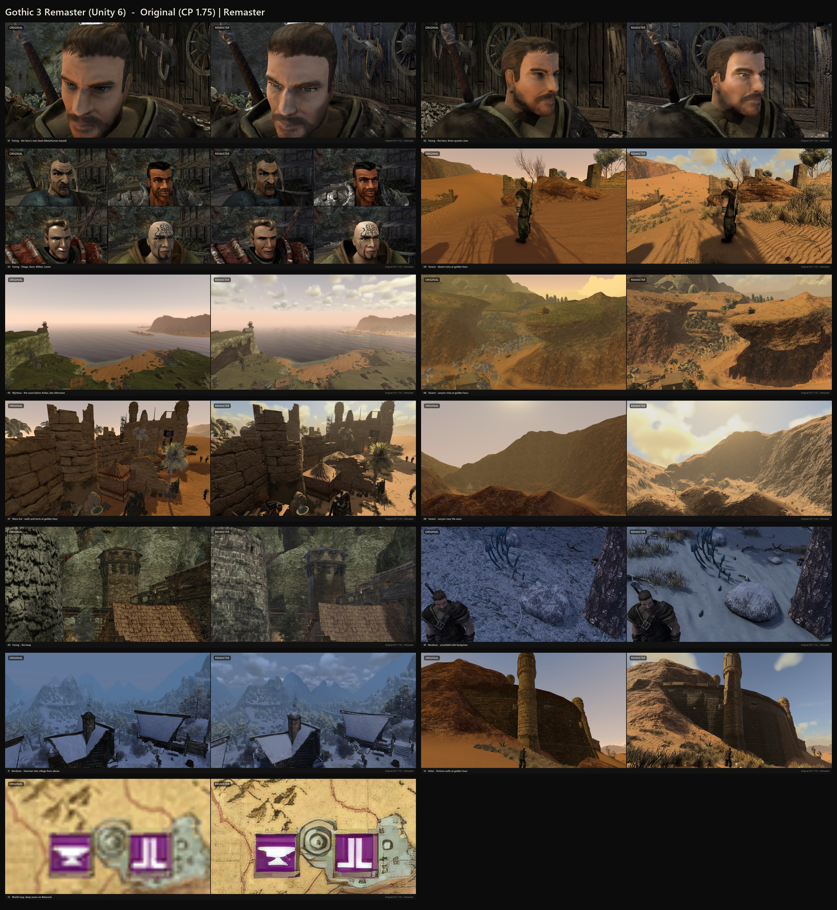
</p>

<h1 align="center">Myrtana</h1>

<p align="center">
  <b>Unofficial open-source Gothic 3 engine on Unity 6, with an optional remaster.</b><br>
  <b>Неофициальный открытый движок Gothic 3 на Unity 6 с ремастером по желанию.</b>
</p>

<p align="center">
  <a href="#русский">Русский</a> · <a href="#english">English</a>
</p>

> [!IMPORTANT]
> Myrtana is a fan project. It is not affiliated with or endorsed by THQ Nordic, Piranha Bytes or the Community Patch team.
> The repository contains **no game files**: you need your own copy of **Gothic 3** (Steam or GOG) with **Community Patch 1.75**.
>
> Myrtana — фанатский проект, не связанный с THQ Nordic, Piranha Bytes и командой Community Patch.
> В репозитории **нет файлов игры**: нужна своя копия **Gothic 3** (Steam или GOG) с **Community Patch 1.75**.

---

## Русский

### Что это
Myrtana читает данные установленной Gothic 3 (мир, персонажей, диалоги, квесты, звук, видео) и запускает игру на собственном
коде: симуляция NPC и распорядков, бой, магия, преступления и репутация, торговля, сюжет, сохранения, интерфейс в стиле
оригинала. Поверх оригинального вида можно включить **ремастер** (Настройки → Ремастер или F7): освещение и объёмные
облака, новые материалы земли и скал, песок и снег, деревья, трава, HD-карта, обновлённые лица и броня. По умолчанию
ремастер выключен и игра выглядит как Community Patch 1.75.

### Скриншоты
Слева оригинал, справа ремастер.

| | |
|---|---|
| 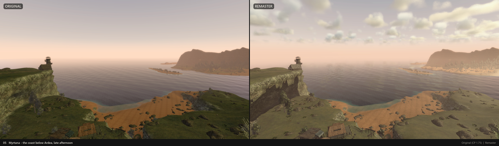 | 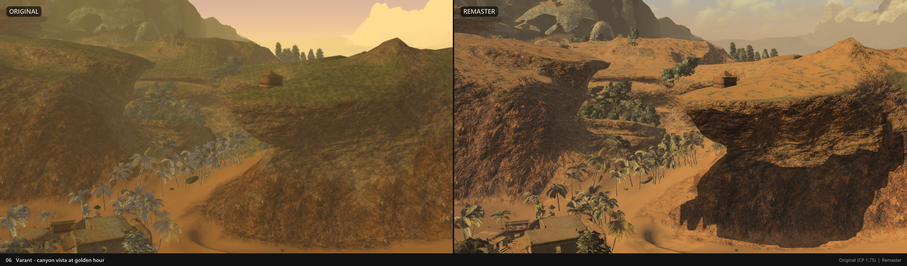 |
| 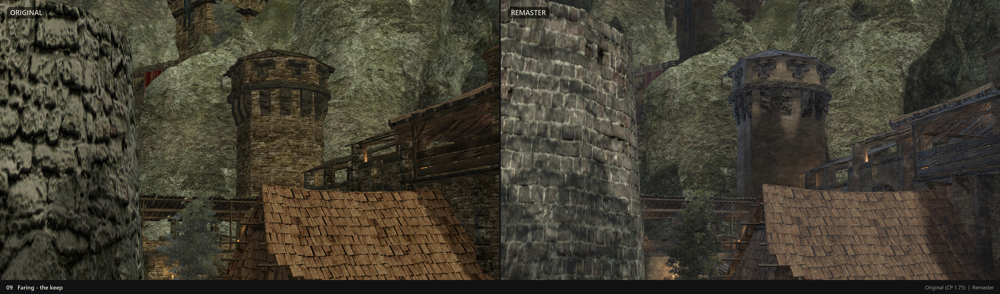 | 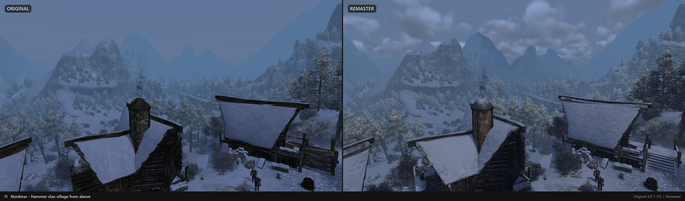 |
| 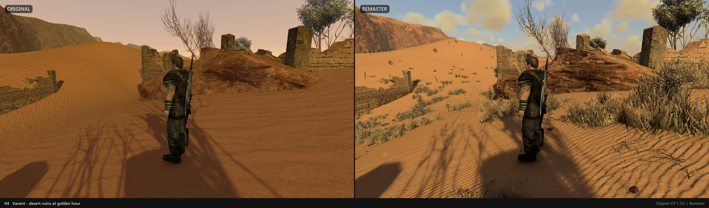 | 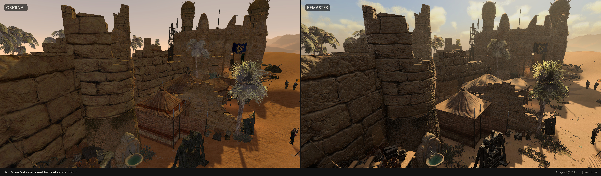 |
| 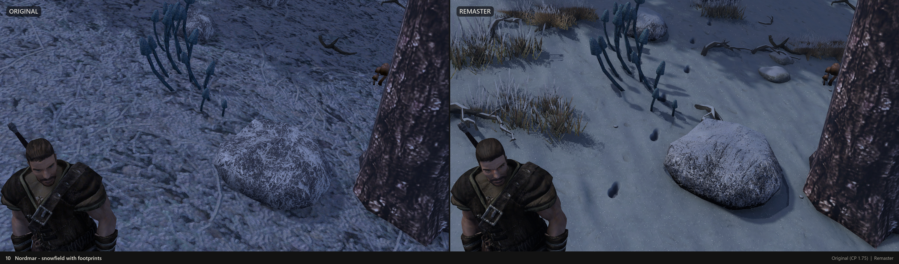 | 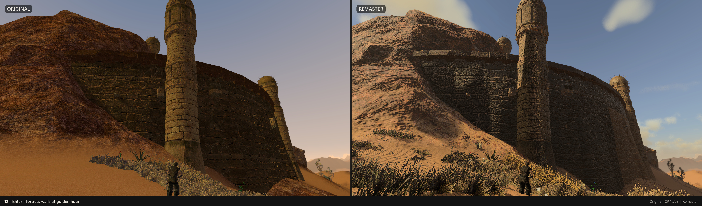 |
| 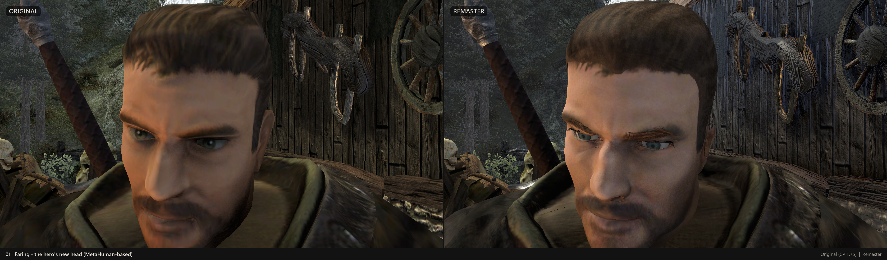 | 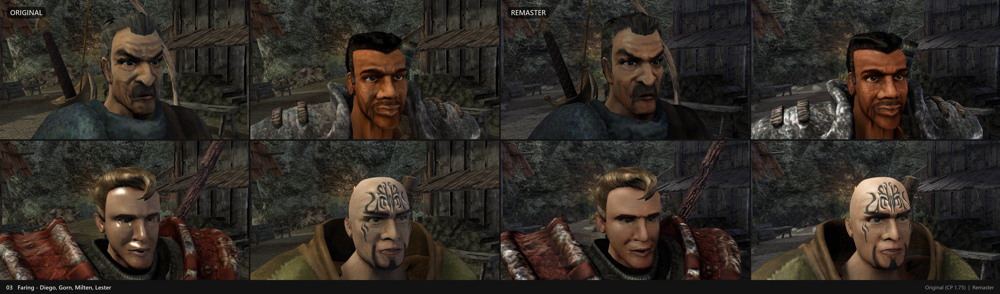 |
| 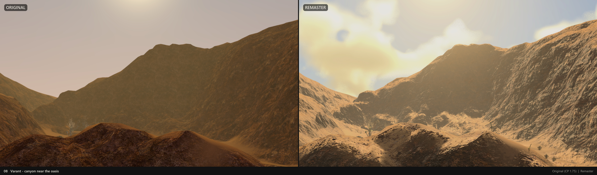 | 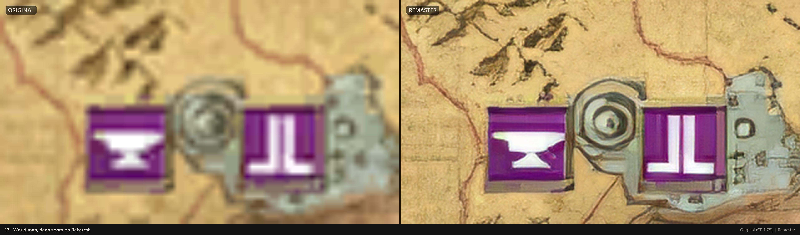 |

### Что нужно
| | |
|---|---|
| Игра | Gothic 3 + Community Patch 1.75 (русская или английская озвучка) |
| ОС, железо | Windows 10/11 x64, 16 ГБ ОЗУ (лучше 32), видеокарта с DirectX 12, ~120 ГБ на диске на время сборки |
| Unity | **6000.6.5f1** через [Unity Hub](https://unity.com/download) (Personal бесплатна) |
| Инструменты | `winget install Microsoft.DotNet.SDK.8 Gyan.FFmpeg Python.Python.3.12`<br>`winget install Microsoft.DotNet.Runtime.8 --architecture x86`<br>`winget install Microsoft.VisualStudio.2022.BuildTools` (нагрузка «Разработка классических приложений на C++») |

### Сборка
```bat
git clone https://github.com/szadev/Myrtana.git
cd Myrtana
Tools\Setup\setup.cmd
```
Скрипт сам находит игру и Unity. Если не нашёл, укажите пути: `Tools\Setup\setup.cmd -GameDir "D:\Games\Gothic 3" -Unity "C:\...\Unity.exe"`.

Что делает скрипт:
1. **check** — проверяет игру, Unity и инструменты;
2. **pack** — скачивает пакет ремастера из [Myrtana-pack](https://github.com/szadev/Myrtana-pack/releases) (около 12 ГБ, части `myrtana-pack-NN.zip`), проверяет контрольные суммы и распаковывает;
3. **font** — строит кириллицу шрифта Gothic 3 из `Gothic3.ttf` вашей установки;
4. **video** — конвертирует ролики `Data/Video/*.bik` в `.webm` через FFmpeg;
5. **import** — Unity импортирует мир, персонажей, звук, эффекты и ремастер (первый раз несколько часов);
6. **build** — собирает игру в `Builds\Demo_<дата>\`. Запуск: `G3World.exe`.

Продолжить с нужного шага: `-From import`. Пакет, скачанный вручную: `-PackDir <папка>`. Без пакета ремастера: `-NoPack`
(тогда соберётся оригинальный вид). Только импорт без сборки: `-NoBuild`, дальше можно открыть проект в Unity.

### Участие
Pull request'ы приветствуются. Код в `Assets/G3` (форматы файлов Gothic 3 и импорт в Unity) и `Assets/Myrtana` (игровая
логика, симуляция, интерфейс), утилиты в `Tools/` (`G3Cli`, `SptBake`, пайплайны ремастера на Python и Blender).
Не добавляйте в репозиторий файлы игры и всё, что из них сделано.

---

## English

### What it is
Myrtana reads the data of an installed Gothic 3 (world, characters, dialogues, quests, sound, video) and runs the game on
its own code: NPC simulation and routines, combat, magic, crime and reputation, trading, story, saves, a UI in the style of
the original. On top of the original look you can switch on the **remaster** (Options → Remaster, or F7): lighting and
volumetric clouds, new ground and rock materials, sand and snow, trees, grass, an HD map, reworked faces and armour. The
remaster is off by default, so the game looks like Community Patch 1.75.

### Requirements
| | |
|---|---|
| Game | Gothic 3 + Community Patch 1.75 (Russian or English speech) |
| OS, hardware | Windows 10/11 x64, 16 GB RAM (32 recommended), DirectX 12 GPU, ~120 GB free disk while building |
| Unity | **6000.6.5f1** via [Unity Hub](https://unity.com/download) (Personal is free) |
| Tools | `winget install Microsoft.DotNet.SDK.8 Gyan.FFmpeg Python.Python.3.12`<br>`winget install Microsoft.DotNet.Runtime.8 --architecture x86`<br>`winget install Microsoft.VisualStudio.2022.BuildTools` (workload "Desktop development with C++") |

### Build
```bat
git clone https://github.com/szadev/Myrtana.git
cd Myrtana
Tools\Setup\setup.cmd
```
The script finds the game and Unity by itself; otherwise pass `-GameDir "D:\Games\Gothic 3" -Unity "C:\...\Unity.exe"`.
Phases: **check** → **pack** (downloads the ~12 GB remaster pack from [Myrtana-pack](https://github.com/szadev/Myrtana-pack/releases), verifies and unpacks it) → **font** (Cyrillic for the
Gothic 3 font, built from your `Gothic3.ttf`) → **video** (`Data/Video/*.bik` to `.webm` with FFmpeg) → **import** (Unity
imports world, characters, audio, effects and remaster; several hours the first time) → **build** (the game in
`Builds\Demo_<date>\`, start `G3World.exe`). Resume with `-From <phase>`; a manually downloaded pack: `-PackDir <folder>`;
original look only: `-NoPack`; import without building: `-NoBuild`.

### Contributing
Pull requests are welcome. `Assets/G3`: Gothic 3 file formats and the Unity import; `Assets/Myrtana`: game logic,
simulation, UI; `Tools/`: `G3Cli`, `SptBake`, remaster pipelines (Python, Blender). Never commit game files or anything
derived from them.

---

## Credits / Благодарности

* **Gothic 3** © THQ Nordic GmbH, developed by Piranha Bytes. **Community Patch** by the Gothic 3 Community Patch team.
  Myrtana uses neither their code nor their files; everything is read from the player's own installation.
* Replacement tree models (`Assets/G3/Trees/Models`), Sketchfab, **CC BY 4.0**, modified (joined, re-pivoted, LODs,
  snow variants, downscaled textures):
  Spruce, Fir, Pine, Petiolate oak, Linden, Elm — *intice184*; Acacia — *evolveduk*;
  Realistic Palm Tree Free, Realistic Palm Tree 4 Free — *NextSpring*; bush — *levandreev23032010*.
* Materials and scans: [Poly Haven](https://polyhaven.com) and [ambientCG](https://ambientcg.com), **CC0 1.0**.
* Remaster textures were made with [Real-ESRGAN](https://github.com/xinntao/Real-ESRGAN) (BSD-3-Clause),
  [Stable Diffusion XL](https://huggingface.co/stabilityai/stable-diffusion-xl-base-1.0) (CreativeML Open RAIL++-M) and
  [ControlNet Tile SDXL](https://huggingface.co/xinsir/controlnet-tile-sdxl-1.0) (Apache-2.0) in
  [ComfyUI](https://github.com/Comfy-Org/ComfyUI), plus [Blender](https://www.blender.org).

## License / Лицензия
The source code of this repository: [MIT](LICENSE). The remaster pack is distributed separately and only for use with a
legally owned copy of Gothic 3; rights holders can contact the maintainer through GitHub issues, and content will be
removed on request.

Исходный код: [MIT](LICENSE). Пакет ремастера распространяется отдельно и только для использования с легальной копией
Gothic 3; правообладатели могут связаться через issues на GitHub, материалы будут удалены по запросу.
